# Entity Relationship Diagram

The domain is anchored on `events`. Every guest-facing table carries `event_id` so that a token,
a report query, or an admin action can be scoped to exactly one wedding.

```mermaid
erDiagram
    USERS ||--o{ EVENTS : "creates (created_by)"
    USERS }o--o{ EVENTS : "event_user"
    EVENTS ||--o{ EVENT_SETTINGS : has
    EVENTS ||--o{ EVENT_VENUES : has
    EVENTS ||--o{ EVENT_SCHEDULES : has
    EVENTS ||--o{ GIFT_ACCOUNTS : has
    EVENTS ||--o{ GUEST_CATEGORIES : has
    EVENTS ||--o{ GUEST_GROUPS : has
    EVENTS ||--o{ GUESTS : has
    EVENTS ||--o{ INVITATIONS : has
    EVENTS ||--o{ RSVPS : has
    EVENTS ||--o{ CHECKINS : has
    EVENTS ||--o{ GUESTBOOK_MESSAGES : has
    EVENTS ||--o{ MEDIA_ALBUMS : has
    EVENTS ||--o{ MEDIA_ASSETS : has
    EVENTS ||--o{ SEATING_TABLES : has
    EVENTS ||--o{ TABLE_ASSIGNMENTS : has
    EVENTS ||--o{ SONG_REQUESTS : has
    EVENTS ||--o{ POLLS : has
    EVENTS ||--o{ GAMES : has
    EVENTS ||--o{ EVENT_ACTIVITIES : has
    EVENTS ||--o{ AUDIT_LOGS : "optional scope"

    GUESTS ||--o{ GUEST_TOKENS : owns
    GUESTS ||--o| INVITATIONS : "one active invitation"
    GUESTS ||--o| RSVPS : "one response"
    GUESTS ||--o| CHECKINS : "one check-in"
    GUESTS ||--o{ GUESTBOOK_MESSAGES : writes
    GUESTS ||--o{ MEDIA_ASSETS : uploads
    GUESTS ||--o{ SONG_REQUESTS : requests
    GUESTS ||--o{ POLL_RESPONSES : casts
    GUESTS ||--o{ GAME_ATTEMPTS : plays
    GUESTS ||--o| TABLE_ASSIGNMENTS : seated

    POLLS ||--o{ POLL_OPTIONS : offers
    POLLS ||--o{ POLL_RESPONSES : collects
    POLL_OPTIONS ||--o{ POLL_RESPONSES : chosen

    GAMES ||--o{ GAME_QUESTIONS : contains
    GAMES ||--o{ GAME_ATTEMPTS : records
    GAME_QUESTIONS ||--o{ GAME_OPTIONS : offers
    GAME_ATTEMPTS ||--o{ GAME_ANSWERS : stores
    GAME_QUESTIONS ||--o{ GAME_ANSWERS : answered
    GAME_OPTIONS ||--o{ GAME_ANSWERS : selected

    MEDIA_ALBUMS ||--o{ MEDIA_ALBUM_ITEMS : groups
    MEDIA_ASSETS ||--o{ MEDIA_ALBUM_ITEMS : "added to"
    GUESTBOOK_MESSAGES ||--o{ GUESTBOOK_FAVORITES : favourited
    USERS ||--o{ GUESTBOOK_FAVORITES : marks

    SEATING_TABLES ||--o{ TABLE_ASSIGNMENTS : seats

    USERS ||--o{ AUDIT_LOGS : acts
    USERS ||--o{ EVENT_ACTIVITIES : acts
    USERS ||--o{ NOTIFICATIONS : receives
```

## Cardinality notes

| Relationship | Rule |
| --- | --- |
| `events.created_by` | nullable; set to `null` when the creating admin is deleted |
| `event_user` | unique `(event_id, user_id)`; `role_label` is `groom`, `bride` or `partner` |
| `guests` | soft-deleted; unique per event only by name index, not by constraint |
| `guest_tokens` | many per guest (invitation + QR, plus revoked history); `token_hash` unique |
| `invitations` | exactly one row per guest (`guest_id` unique) |
| `rsvps` | at most one row per guest per event (`unique(event_id, guest_id)`) |
| `checkins` | at most one row per guest per event (`unique(event_id, guest_id)`) |
| `guestbook_messages` | one guest may write many; `guest_id` nullable for imported/legacy messages |
| `poll_responses` | one vote per guest per poll (`unique(poll_id, guest_id)`) |
| `game_attempts` | one attempt per guest per game (`unique(game_id, guest_id)`) |
| `game_answers` | one answer per question per attempt (`unique(game_attempt_id, game_question_id)`) |
| `table_assignments` | one table per guest per event (`unique(event_id, guest_id)`) |
| `media_album_items` | unique `(media_album_id, media_asset_id)` |

## Status enums

| Column | Values |
| --- | --- |
| `events.status` | `draft`, `published`, `live`, `completed`, `archived` |
| `event_schedules.status` | `planned`, `ongoing`, `done` |
| `guests.status` | `active`, `inactive`, `blocked` |
| `guests.rsvp_status` / `rsvps.status` | `pending`, `confirmed`, `declined`, `maybe` |
| `guest_tokens.type` | `invitation`, `qr` |
| `invitations.status` | `not_sent`, `link_opened`, `shared_manually`, `sent` |
| `checkins.method` | `qr`, `manual` |
| `guestbook_messages.visibility` | `public`, `private` |
| `guestbook_messages.status` | `pending`, `approved`, `rejected`, `hidden` |
| `media_assets.status` | `pending`, `approved`, `rejected` |
| `song_requests.status` | `pending`, `approved`, `played`, `rejected` |
| `games.type` | `quiz` |
| `users.role` | `superadmin`, `owner` |

## Guest action gating

`Event::allowsGuestActions()` is true only for `published` and `live` events. RSVP additionally
requires `rsvp_enabled` and either no `rsvp_deadline` or a future deadline. Each guest feature
(guestbook, gallery, gift, live wall) has its own boolean flag on `events`.
