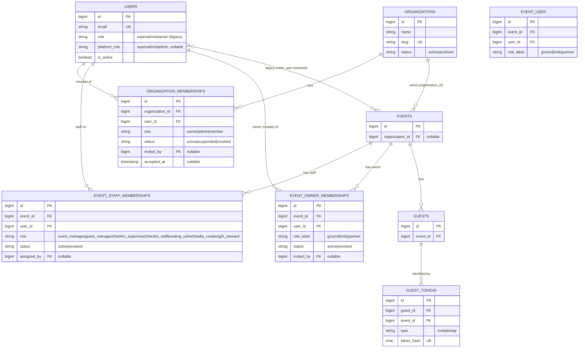

# Identity Architecture

**Milestone 2 — Identity, Membership & Permission Foundation**
Status: Implemented — 2026-11-09

---

## 1. Purpose

VOWSPACE grew from a single-tenant wedding app into a multi-workspace product. This
document describes the identity model that supports that shift **without breaking** the
existing authentication, event ownership, and guest access mechanisms.

There is exactly **one global identity per person** (`users`). Every other relationship in
this document is a *role* held by that identity — not a separate account. A single person
can be a Workspace Owner in one organization, a Basic Member in another, an Event Manager
on one event, and a Guest on someone else's wedding, all with the same login.

This document defines the layers. Enforcement rules live in
[PERMISSIONS.md](PERMISSIONS.md); onboarding lives in
[WORKSPACE-ONBOARDING.md](WORKSPACE-ONBOARDING.md); invitations in
[INVITATIONS.md](INVITATIONS.md).

---

## 2. The five identity layers

| Layer | Table | Represents | Authentication |
| --- | --- | --- | --- |
| Global user | `users` | The person / login account | Email + password |
| Platform authority | `users.platform_role` | Staff of VOWSPACE itself | Column on the user |
| Organization (workspace) membership | `organization_memberships` | Membership of a workspace | Session |
| Event staff membership | `event_staff_memberships` | Operational role on one event | Session |
| Event owner (couple) membership | `event_owner_memberships` | Groom / bride / partner on one event | Session |
| Guest identity | `guest_tokens` / `guests` | An invited visitor | Opaque bearer token |

Guest identity is deliberately **not** an account: guests never log in and are identified
only by an opaque token (see §7).

---

## 3. Global user identity (`users`)

Model: `App\Models\User`

- One row per person. `email` is unique (`unique:users,email` at registration).
- Soft-deleted via `deleted_at`; `is_active` is a separate flag (`EnsureActiveUser`
  logs a user out when it is `false`).
- `role` — the **legacy** customer enum `App\Enums\UserRole` (`superadmin`, `owner`). It
  pre-dates Milestone 2 and still drives `/admin` and `/owner` route gates.
- `platform_role` — the **explicit platform authority** enum `App\Enums\PlatformRole`
  (`superadmin`, `admin`), nullable. Added in Milestone 2.
- `email_verified_at` — cast to `datetime` but **not enforced** (see §8).

### Platform role vs customer role

The two columns answer different questions and must not be conflated:

| | `users.role` (`UserRole`) | `users.platform_role` (`PlatformRole`) |
| --- | --- | --- |
| Meaning | Legacy global gate for `/admin` vs `/owner` | VOWSPACE staff authority |
| Values | `superadmin`, `owner` | `superadmin`, `admin` (nullable) |
| Set by registration | Always `owner` | **Never** (stays `null`) |
| Set by | Seeder / platform operator | Seeder / platform operator |
| Used by | `EnsureRole` middleware, `User::isSuperadmin()` | `User::isPlatformAdmin()` / `isPlatformSuperadmin()` |

`User::isPlatformAdmin()` is simply `platform_role !== null`. Helper predicates:

```php
$user->isSuperadmin();          // legacy UserRole::Superadmin
$user->isPlatformSuperadmin();  // PlatformRole::Superadmin
$user->isPlatformAdmin();       // any platform_role
```

Both `isSuperadmin()` and `isPlatformSuperadmin()` are treated as a full bypass in the
permission service and middleware (see [PERMISSIONS.md](PERMISSIONS.md)).

---

## 4. Relationship diagram (actual tables and keys)



Key constraints:

| Table | Unique | Notes |
| --- | --- | --- |
| `organization_memberships` | `(organization_id, user_id)` | One membership row per user per org |
| `event_staff_memberships` | `(event_id, user_id, role)` | A user may hold **multiple** roles on one event |
| `event_owner_memberships` | `(event_id, user_id)` | A user holds **one** couple role per event |
| `event_user` | `(event_id, user_id)` | Legacy pivot, retained, not migrated away from |
| `guest_tokens` | `token_hash` | SHA-256 of a 64-char raw token |

---

## 5. What each relationship grants — and what it does *not*

| Relationship | Grants | Does **not** grant |
| --- | --- | --- |
| `users.platform_role` (superadmin/admin) | Global bypass of org and event permission checks | — (it is the top of the hierarchy) |
| `users.role` = `superadmin` (legacy) | `/admin` access; full bypass in `PermissionService` | Intended for platform operation, not tenant work |
| `organization_memberships` (active) | Workspace access + the org permission set for its role (Owner / Admin / Member) | Event-staff operational rights beyond its role; anything in another organization |
| `event_staff_memberships` (active) | The permission set of that `EventStaffRole`, scoped to that one event | Workspace membership; org-level permissions; access to other events or orgs |
| `event_owner_memberships` (active) | Event **access** as the couple (`canAccessEvent`, `isEventOwner`) | Operate the event. A couple member is **not** automatically an org member or event staff |
| legacy `event_user` pivot | Legacy event access fallback when an event has no `organization_id` | Any Milestone 2 permission; it is not org-scoped |
| `guest_tokens` | Token-scoped guest actions (RSVP, wishes, uploads, polls, games) | Login, account, or any authenticated route |

The three user relationships — organization membership, event staff membership, and event
owner membership — are **distinct and independent**. Creating one never creates another:

- A couple (`event_owner_memberships`) is **not** given an `organization_memberships` row.
  This is asserted by `CoupleInvitationTest` and `EventOwnerMembershipTest`.
- An event owner is **not** automatically event staff (`EventStaffMembership`), so holding
  ownership does not by itself unlock operational permissions.
- A staff invitation creates an org membership **and** event staff rows, but never an owner
  membership.

---

## 6. Event access resolution (`User::canAccessEvent`)

`User::canAccessEvent(Event|int)` is the single access predicate used by policies:

1. Legacy `UserRole::Superadmin` → always `true`.
2. If the event has an `organization_id`, access is granted when **any** of these holds:
   - an **active** `organization_membership` for that org;
   - an **active** `event_staff_membership` for that event;
   - an **active** `event_owner_membership` for that event.
   Suspended/revoked memberships are denied even though the row exists.
3. If the event has **no** `organization_id` (not yet backfilled), the legacy
   `event_user` pivot check applies.

`PermissionService::isEventOwner()` and `Event::hasOwnerMember()` / `hasStaffMember()`
provide the narrower, active-only checks used by the permission matrix.

---

## 7. Guest identity (tokens, not accounts)

Guests are the one identity that is intentionally **not** a `users` row:

- A guest is a `guests` row scoped to one `event_id`.
- Access is through `guest_tokens`: `type` `invitation` or `qr`, with `token_hash`
  (`sha256` of a 64-char raw token), an encrypted `token_ciphertext` for re-display, and
  optional `expires_at` / `revoked_at`.
- `ResolveGuestToken` hashes the URL token, resolves exactly one guest + event, and injects
  them into the request. Unknown/expired/revoked tokens return the `guest.invalid` view with
  HTTP 404.
- Every guest write is scoped to the token's event; the guest cannot supply another
  `event_id`, poll id, or game id.

Guest actions are gated by event status and per-feature flags, **not** by the
`PermissionRegistry`. See [ROLES.md](ROLES.md) §Token model and
[USER-JOURNEY.md](USER-JOURNEY.md) §3.

---

## 8. Known limitations

- **No email verification.** `App\Models\User` does **not** implement
  `Illuminate\Contracts\Auth\MustVerifyEmail`, and no verification route/middleware is
  registered. `email_verified_at` is cast on the model but is not populated at registration
  and is not enforced anywhere. Registration and invitation acceptance therefore trust the
  submitted email address.
- **`Organization::users()` / `User::organizations()` pivot defect.** Both relations use
  `->using(OrganizationMembership::class)`, but `OrganizationMembership` extends
  `Illuminate\Database\Eloquent\Model`, not `Pivot`. Calling `attach()` with pivot
  attributes on these relations throws `fromRawAttributes()` errors. Membership rows must be
  created through `OrganizationMembership::create()` or the workspace services — never
  `$org->users()->attach(...)`. (Contrast `User::events()`, which uses the real `EventUser`
  pivot and *does* support `attach()`.)
- **Owner routes still use the legacy pivot.** `ResolvesOwnerEvent` and `User::eventIds()`
  resolve events through `event_user`, not `event_owner_memberships`. The couple
  membership table is the canonical replacement for the pivot but the owner UI does not read
  it yet. See [TENANCY.md](TENANCY.md) §8 and [PERMISSIONS.md](PERMISSIONS.md).
- **`event_user` is retained.** It is not dropped by any Milestone 2 migration and is still
  written by the superadmin owner-sync flow. See [MILESTONE-2-MIGRATION.md](MILESTONE-2-MIGRATION.md).
- **Legacy `events.organization_id` stays nullable.** Events created before tenancy are
  backfilled into the "Legacy Workspace" organization, but the column is not yet `NOT NULL`.
